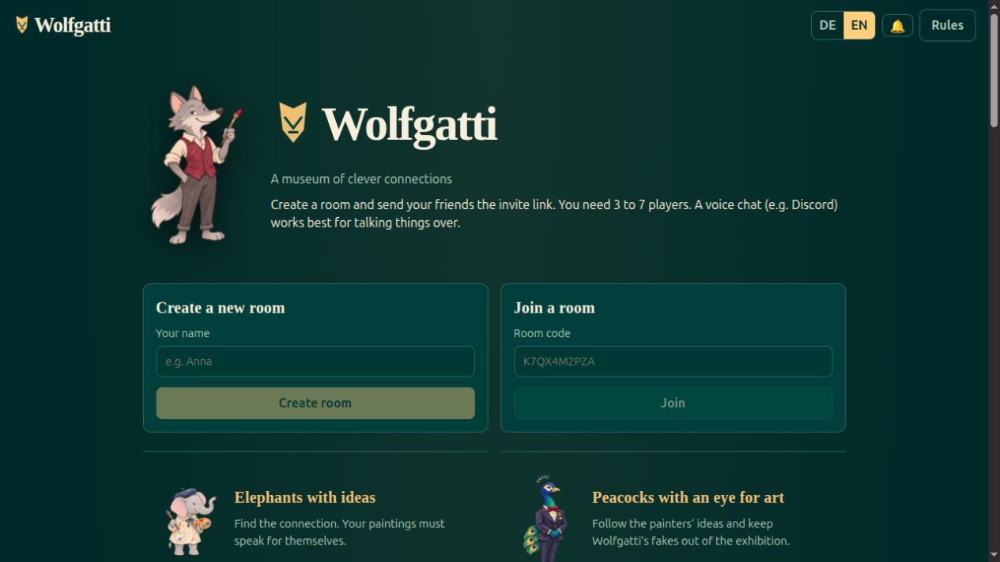

# Wolfgatti

A cooperative museum card game for 3–7 players. Elephant painters submit pictures, peacock curators arrange the
exhibition, and the wolf Wolfgatti slips in forgeries. Create a room, share its invitation link, and play together
in German or English on a computer or phone.

Wolfgatti uses original illustrations and its own visual identity. The 168 picture subjects are catalogued
separately from their artwork. Transparent motifs, decorative frames, backgrounds, and game markers are separate
layers, so the card design can change without repainting the deck.



## Play

- One player creates a room and sends the invitation link to the others. No accounts are needed.
- Use a voice call or sit together to discuss the cards. Voice chat is not built into the game.
- Roles rotate between painters and curators. Everyone cooperates against Wolfgatti.
- Two pictures provide the themes. Painters choose related pictures from their hands; curators must recognise
  those connections while rejecting four randomly added forgeries.
- The interface explains the phases, communication restrictions, scoring, and four shared helper cards.
- The host can choose Normal or Easy difficulty. Easy reveals the submitted picture count for each theme.

Each player chooses their own interface language. Reloading or reconnecting restores their seat using a token
stored in that browser. Spectators can take over disconnected seats.

## Run with Docker

Requires Docker with Compose. Download the image from GitHub Container Registry and start it:

```bash
docker compose pull
docker compose up -d
```

Open `http://localhost:8080`. The image is `ghcr.io/shyper/wolfgatti:latest`; it contains the client, server, and game assets.
No database service is required. Room state is held in memory and saved as JSON snapshots in the
`wolfgatti-data` volume so a container restart can preserve active rooms.

To update, run both commands again. The `latest` image is published after successful CI checks on pushes to `main`
in [shyper/wolfgatti](https://github.com/shyper/wolfgatti). It becomes available after the first successful publish.
If the package is private, authenticate with `docker login ghcr.io` before pulling.

For access over the internet, place an HTTPS
reverse proxy in front of port 8080 and allow WebSocket upgrades. HTTPS also enables browser sharing and clipboard
features. Set `TRUST_PROXY=1` only when requests come through a trusted reverse proxy.

| Variable | Default | Purpose |
|---|---|---|
| `WOLFGATTI_PORT` | `8080` | Host port used by Compose |
| `ROOM_TTL_MINUTES` | `120` | Expiry time for rooms with no connected members |
| `ACCESS_PASSWORD` | empty | Optional password for creating rooms; invitation links still allow joining |
| `TRUST_PROXY` | `0` | Trust proxy-supplied client IP information for request limits |

The server responds to `GET /healthz` with `ok`. No existing database or earlier game data needs to be imported.
Do not publish room snapshots: they include reconnect tokens and hidden game state.

## Develop

Requires Node.js 24 and npm.

```bash
npm ci
npm run dev:server
```

In a second terminal:

```bash
npm run dev:client
```

The development client runs at `http://localhost:5173` and forwards Socket.IO and API requests to the server at
port 3300. For multiple players on one machine, use separate browser profiles or different origins such as
`localhost`, `127.0.0.1`, and `a.localhost`; each origin has independent browser storage.

| Command | Purpose |
|---|---|
| `npm test` | Engine and room tests, including hidden-information checks |
| `npm run typecheck` | TypeScript checks across the three application packages |
| `npm run i18n:check` | Compare German and English translation keys |
| `npm run assets:version` | Refresh content fingerprints after replacing web artwork |
| `npm run assets:check` | Validate catalog completeness, files, alpha headers, masters, provenance, and duplicates |
| `npm run assets:check:alpha` | Optional full-pixel transparency check; requires Python and Pillow |
| `npm run build` | Build the Vite client and bundled Node server |

All 168 motif illustrations, three character illustrations, four illustrated helper fronts and four numbered
reverses are included, with their PNG masters and generation records. The active card background is an unframed
painted canvas without fabric weave. The completed local checks are documented in [VERIFICATION.md](docs/VERIFICATION.md).

To exercise a running local server with three automated players and a spectator, run `npm run test:smoke`.
This checks a complete match, helpers, role changes, reconnect, hidden information and return to the lobby.
Set `WOLFGATTI_TEST_URL` only to a disposable test instance.

For a local production run after building:

```bash
PUBLIC_DIR="$PWD/packages/client/dist" DATA_DIR="$PWD/.work/rooms" node packages/server/dist/index.cjs
```

This starts the server at port 3300. Set `PORT` to choose another port. Keep runtime data inside the project when
working under the project-boundary instructions.

## Structure

```text
packages/
  shared/      Game engine, rules, protocol types, filtered player views
  server/      HTTP/Socket.IO server, room management, JSON snapshots
  client/      React UI, translations, card composition, web assets
assets/
  catalog.json Picture subjects and bilingual accessible names
  masters/     Original generated image files
  provenance/  Generation prompts and asset records
docs/
  ARTWORK.md   Illustration style, file conventions, and review process
  style-studies/ Approved references and retained design studies
tools/         Translation and asset checks
```

Original scanned card artwork and logos are not distributed with Wolfgatti.

## License

Wolfgatti's own code, documentation, and original project artwork are provided under the [MIT License](LICENSE),
to the extent the contributors can grant the relevant rights. The illustrations were created with AI assistance;
see [artwork provenance](docs/ARTWORK.md). Third-party software keeps its own license and copyright notices in
[THIRD_PARTY_NOTICES.md](THIRD_PARTY_NOTICES.md).

See [CONTRIBUTING.md](CONTRIBUTING.md) for contribution guidelines. The source repository is
[shyper/wolfgatti](https://github.com/shyper/wolfgatti). No hosted game instance is configured by this implementation.
